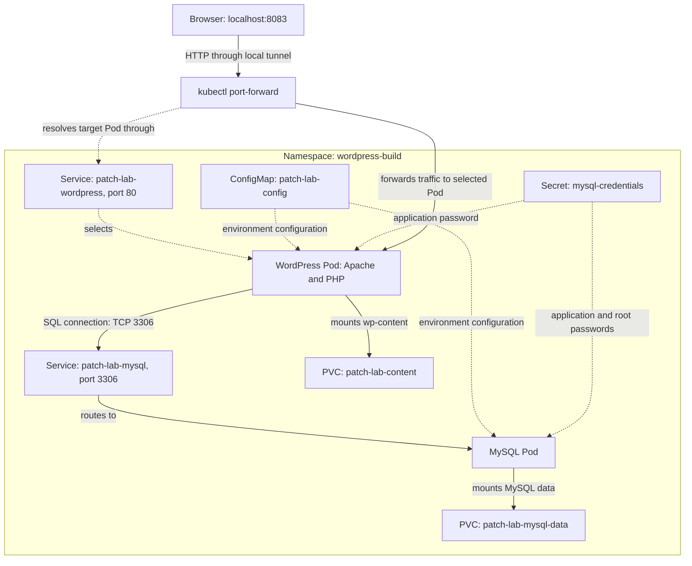
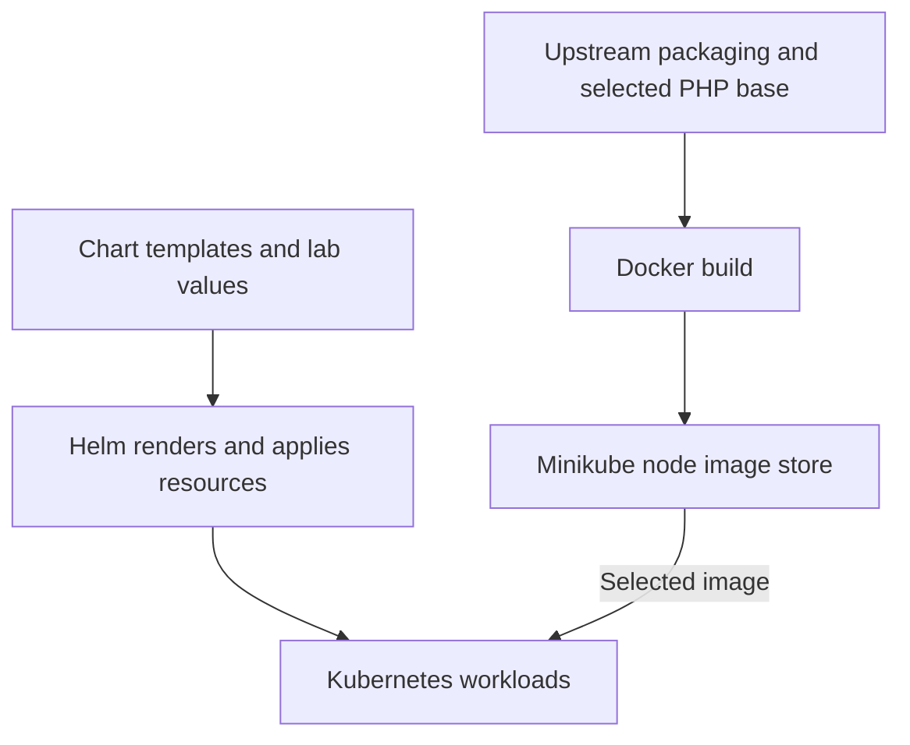
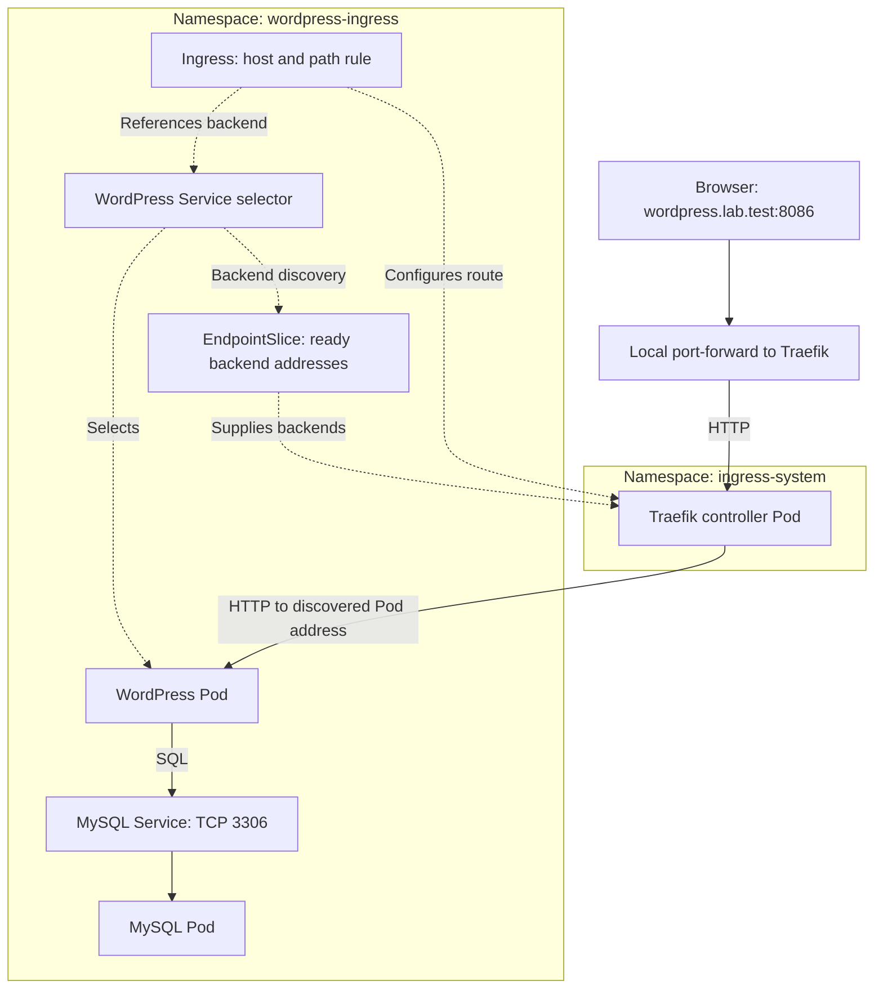

# Application architecture

Reviewed against chart 0.2.0 and the recorded labs on 2026-11-02.
This describes the implemented design and historical installations, not a
live cluster inventory. All workloads use the kiratech context on a
single-node Minikube cluster.

## Deployment variants and boundaries

The project deploys copies of the same WordPress/MySQL application for
separate experiments. The namespaces below are not application tiers that
communicate with one another. Each application installation has its own
Services, configuration, credential Secret and storage where provisioned.
Namespaces organize resources; no NetworkPolicy isolation was implemented.

| Purpose | Namespace | Delivery / release | Recorded local access |
| --- | --- | --- | --- |
| Original deployment and persistence | wordpress | kubectl, k8s/stack.yaml | localhost:8080 |
| Failed MySQL initialization reproduction | wordpress-check | kubectl; MySQL-only reproduction | No WordPress endpoint |
| Corrected clean installation | wordpress-check-clean | kubectl | localhost:8081 during the test |
| Published-image security update | wordpress-security | kubectl, labs/security/ | localhost:8082 |
| Custom build and Helm update | wordpress-build | Helm, patch-lab | localhost:8083 |
| Missing-image incident | wordpress-troubleshooting | Helm, image-lab | localhost:8084 during recovery |
| Clean-checkout validation | wordpress-validation | Helm, validation | localhost:8085; installation subsequently removed |
| Ingress application | wordpress-ingress | Helm, ingress-lab | wordpress.lab.test:8086 |
| Ingress controller | ingress-system | Helm, traefik | Target of the local 8086:80 tunnel |

Ports are chosen by the local port-forward commands, not by chart values.
They are not permanent listeners: the relevant tunnel must be running.
The diagrams below focus on the custom-image application and the Ingress
variant; both use the same application/database/storage design.

## Local execution environment

Docker Desktop supplies Docker access to Ubuntu WSL2. The Minikube Docker
driver hosts the single Kubernetes node in a Docker container. That node
runs both control-plane components and application workloads, using containerd
as its container runtime. This is distinct from Docker's local build image store.

Docker builds the custom images on the workstation. They are loaded into the
Minikube node before deploying values that specify imagePullPolicy Never.
The CLI tools operate from WSL; the browser can run on Windows.
[Local setup](local-setup.md) records the initial environment and allocation.

## Custom-image Helm lab — direct port-forward access



Solid arrows represent application traffic or volume mounts, as labelled.
Dashed arrows represent configuration references or Pod selection.

## Application and workloads

WordPress is an existing open source CMS.
Apache receives HTTP requests and PHP executes WordPress.
WordPress retrieves posts, settings, accounts and attachment metadata
from MySQL. Uploaded image files are stored under wp-content.

Each application component runs in a Deployment with one replica.
MySQL uses a Deployment plus a PVC in this lab, not a StatefulSet or a
database operator. There is no replication or automated failover.
Deployments manage ReplicaSets, which maintain the Pods.
Both use Recreate, so replacement can cause a service interruption.

## Networking and access

Both Services are ClusterIP Services.
WordPress connects to patch-lab-mysql using cluster DNS.
The database is not exposed externally.

```bash
kubectl --context=kiratech -n wordpress-build port-forward service/patch-lab-wordpress 8083:80
```

Open http://localhost:8083.
kubectl uses the Service to select a Pod and forwards traffic to that Pod.
Keep the terminal open; reopen the tunnel after Pod replacement if needed.

This reference installation uses direct port-forward without Ingress.
The separate wordpress-ingress installation uses Traefik; see
[the Ingress diagram](#optional-ingress-deployment) below.

## Resource ownership and selectors

| Resource | Helm application name | Responsibility |
| --- | --- | --- |
| WordPress Deployment / Service | <release>-wordpress | Run Apache/PHP/WordPress; select its frontend Pod on port 80 |
| MySQL Deployment / Service | <release>-mysql | Run the database; expose internal SQL access on port 3306 |
| ConfigMap | <release>-config | Database name, application username and MySQL Service hostname |
| Content PVC | <release>-content | Request persistent WordPress content storage |
| Database PVC | <release>-mysql-data | Request persistent MySQL storage |
| Optional Ingress | <release>-wordpress | Host/path rule referencing the WordPress Service |
| Existing Secret | mysql-credentials by default | Supply database passwords; created separately from the chart |

The application Helm release manages its chart resources. The namespace and
Secret are prepared separately. Traefik is a different Helm release and is
not installed by the WordPress chart. Kubernetes creates ReplicaSets, Pods
and EndpointSlices from the declared workloads and Services.

Service selectors match app=wordpress, app.kubernetes.io/instance=<release>
and tier=frontend or tier=mysql. The release label distinguishes installations
using the chart. The original kubectl manifest instead uses fixed resource
names and app/tier selectors.

## Configuration and credentials

The ConfigMap supplies the database name, application username and host.
The separately created Secret supplies database passwords.

WordPress receives the application password.
MySQL also receives the root password for initialization.
The WordPress administrator login is separate from database credentials.

Chart values contain the Secret name, not its passwords.
Local credential files and backups are excluded from Git.
These values are injected as environment variables when a container starts;
editing a Secret does not automatically change a running process or a MySQL
account password. Database account changes require coordinated handling.

ConfigMap values have the same startup-only environment behavior. A ConfigMap-only
Helm upgrade does not change the Pod template; this chart has no checksum
annotation to trigger a rollout. A reviewed configuration update therefore
requires an explicit restart of affected consumers, followed by verification.
Database names, users and passwords also require changes to the initialized
database itself; restarts do not migrate them. See the
[configuration-update procedure](runbook.md#configuration-updates-and-running-pods).

The labs use automatic-update disabling only for controlled image comparisons.

## Storage

| Component | Persistent mount | PVC |
| --- | --- | --- |
| WordPress | /var/www/html/wp-content | patch-lab-content |
| MySQL | /var/lib/mysql | patch-lab-mysql-data |

Both PVCs request 2Gi with ReadWriteOnce access.
The claims bind to PersistentVolumes provisioned through the standard
StorageClass on the Minikube node. The templates omit storageClassName,
so they rely on the cluster's default StorageClass. A Pod references a PVC;
the mounted filesystem is backed by the bound volume.

WordPress core files come from the container image.
Only wp-content is persisted, allowing core replacement through image updates.

Pod replacement and the custom-image upgrade preserved the tested content.
Node failure recovery and survival after PVC or cluster deletion were not tested.
The StorageClass uses the Delete reclaim policy. Persistence is not a backup.

## Probes and resources

The following describes the current chart 0.2.0; older captured Deployments
may show earlier probe settings.

- WordPress startup/readiness: HTTP request to /wp-login.php, with a five-second timeout.
- WordPress liveness: TCP check on the HTTP port.
- MySQL startup/readiness/liveness: TCP checks.
- Both workloads define CPU/memory requests and limits.

The MySQL incident demonstrated that a listening TCP port does not prove
successful authentication or complete database initialization.
The Ingress incident showed that application readiness also does not validate
the Service selector or the complete browser-to-application path.

| Workload | CPU request / limit | Memory request / limit |
| --- | --- | --- |
| WordPress | 100m / 1 CPU | 128Mi / 512Mi |
| MySQL | 100m / 1 CPU | 512Mi / 1Gi |
| Traefik, separate lab values | 50m / 500m | 64Mi / 256Mi |

These are declared defaults, not measured usage or a capacity guarantee for
running all lab copies simultaneously. Diagnostic evidence uses kubectl
logs/events/resource state, Helm history and Traefik access logs; no centralized
logging or alerting platform was implemented.

## Packaging and deployment

The Helm chart derives from k8s/stack.yaml.
It defines two Deployments, two Services, two PVCs and one ConfigMap,
plus an optional Ingress when enabled in values (chart 0.2.0).
The namespace and Secret are prepared separately.

values.yaml supplies defaults. Lab override files select the image,
pull policy and automatic-update setting.
Resource names and selectors identify the Helm release.



The two remediation paths differ in image preparation and deployment:

| Path | Image change | Deployment change |
| --- | --- | --- |
| Published-image update | Select another published WordPress image pinned by digest | Apply the corrected kubectl manifest in wordpress-security |
| Custom-image update | Change the pinned PHP/Apache FROM base and rebuild; WordPress remains 7.1.3 | Select the local tag through Helm values in wordpress-build |

Helm changes desired resources; Kubernetes controllers reconcile them.
With Recreate, the WordPress container is replaced and mounts the existing
content PVC. The MySQL data lives on its own PVC. Updating an image or rolling
back a Helm release does not restore database contents or validate data/schema
compatibility. The security lab backups and validation are described in their
[reports](README.md#troubleshooting-and-security-remediation).

No registry publishing pipeline, CI/CD runner, GitOps controller or Krateo
integration was deployed. Those are separately labelled proposals in
[delivery workflow](delivery-workflow.md) and [Krateo proposal](krateo-proposal.md).

## Optional Ingress deployment

The application is release ingress-lab in wordpress-ingress. The controller
is the separate traefik release in ingress-system, using chart 42.1.3 and
Traefik v3.7.16 in the recorded test. The WordPress chart creates the Ingress
rule only when ingress.enabled=true; its default is false.



Solid arrows show requests; dashed arrows show configuration and discovery.
For readability, this view omits the same separate ConfigMap, Secret and two
PVC relationships already shown in the application diagram above.

The access path is:

1. Windows hostname resolution maps wordpress.lab.test to 127.0.0.1. Curl
   checks use --resolve instead, without changing DNS.
2. kubectl port-forward service/traefik 8086:80 selects the controller Pod
   and forwards local traffic to it. The Traefik Service is ClusterIP;
   the lab does not depend on an external load-balancer address.
3. Traefik handles the Host header using the Ingress with class traefik,
   host wordpress.lab.test and Prefix path /, referencing the application
   Service on port 80.
4. The EndpointSlice controller discovers matching Pods and readiness.
   Traefik uses discovered backend addresses; the application Service
   ClusterIP is not necessarily a network hop in this configuration.
5. WordPress serves the request and accesses MySQL through its internal Service.

The controller values enable the Kubernetes Ingress provider and disable
CRD/Gateway providers and the dashboard route. Access logs are enabled.
With allowEmptyServices=true, the deliberately mismatched frontend-typo
selector left no backends and the route returned 503. The application Pod
could remain Ready while that routing path failed.

See the [Ingress guide](../labs/ingress/README.md) for setup and the
[selector incident](incidents/ingress-service-selector.md) for diagnosis and recovery.

## Design limits and verified behavior

- Each workload has one replica and local node storage. This is not a
  high-availability design; Recreate updates can interrupt service.
- Pod replacement and the image updates preserved the tested content and
  PVC bindings. Node failure and data survival after PVC/cluster deletion
  were not tested. PVCs are Helm-managed; uninstall can delete their data.
- Backup integrity checks were performed, but restoration was not tested.
- Ingress access was local HTTP. TLS, public DNS and external exposure were
  not tested. Namespaces alone do not provide network isolation.
- The clean-checkout test reused images and the existing cluster; it did not
  demonstrate an entirely new-machine rebuild.
- This document describes resources and verified relationships. Historical
  evidence is not proof that every namespace is currently running.

## Related documentation

- [Installation entry point](delivery-workflow.md)
- [Helm chart and defaults](../charts/kiratech-wordpress/)
- [L2 runbook: five cases](runbook.md)
- [Incident reports](incidents/)
- [Evidence reading guide](evidence/README.md)
- [Custom-image lab](../labs/security-build/README.md)
- [Ingress lab](../labs/ingress/README.md)
