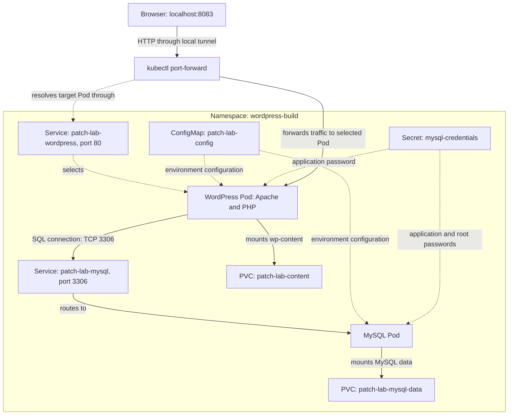
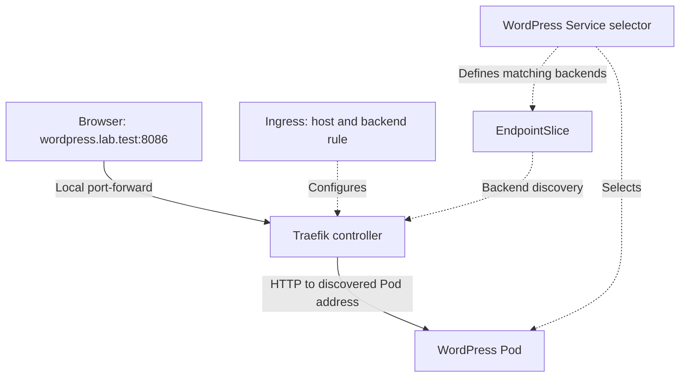

# Application architecture

Reference installation:
- Context: kiratech.
- Namespace: wordpress-build.
- Helm release: patch-lab.
- Single-node minikube cluster.

## Custom-image Helm lab — direct port-forward access



Solid arrows represent application traffic or volume mounts, as labelled.
Dashed arrows represent configuration references or Pod selection.

## Application and workloads

WordPress is an existing open source CMS.
Apache receives HTTP requests and PHP executes WordPress.
WordPress retrieves posts, settings, accounts and attachment metadata
from MySQL. Uploaded image files are stored under wp-content.

Each component runs in a Deployment with one replica.
Deployments manage ReplicaSets, which maintain the Pods.
Both use Recreate, so replacement can cause a service interruption.

## Networking and access

Both Services are ClusterIP Services.
WordPress connects to patch-lab-mysql using cluster DNS.
The database is not exposed externally.

```bash
kubectl --context=kiratech -n wordpress-build port-forward service/patch-lab-wordpress 8083:80
```

Open http://localhost:8083.
kubectl uses the Service to select a Pod and forwards traffic to that Pod.
Keep the terminal open; reopen the tunnel after Pod replacement if needed.

This reference installation uses direct port-forward without Ingress.
The separate wordpress-ingress installation uses Traefik; see
[the Ingress diagram](#optional-ingress-deployment) below.

## Configuration and credentials

The ConfigMap supplies the database name, application username and host.
The separately created Secret supplies database passwords.

WordPress receives the application password.
MySQL also receives the root password for initialization.
The WordPress administrator login is separate from database credentials.

Chart values contain the Secret name, not its passwords.
Local credential files and backups are excluded from Git.

## Storage

| Component | Persistent mount | PVC |
| --- | --- | --- |
| WordPress | /var/www/html/wp-content | patch-lab-content |
| MySQL | /var/lib/mysql | patch-lab-mysql-data |

Both PVCs request 2Gi with ReadWriteOnce access.
The standard StorageClass provisions local volumes on the minikube node.

WordPress core files come from the container image.
Only wp-content is persisted, allowing core replacement through image updates.

Pod replacement and the custom-image upgrade preserved the tested content.
Node failure recovery and survival after PVC or cluster deletion were not tested.
The StorageClass uses the Delete reclaim policy. Persistence is not a backup.

## Probes and resources

- WordPress startup/readiness: HTTP request to /wp-login.php.
- WordPress liveness: TCP check on the HTTP port.
- MySQL startup/readiness/liveness: TCP checks.
- Both workloads define CPU/memory requests and limits.

The MySQL incident demonstrated that a listening TCP port does not prove
successful authentication or complete database initialization.

## Packaging and deployment

The Helm chart derives from k8s/stack.yaml.
It defines two Deployments, two Services, two PVCs and one ConfigMap,
plus an optional Ingress when enabled in values (chart 0.2.0).
The namespace and Secret are prepared separately.

values.yaml supplies defaults. Lab override files select the image,
pull policy and automatic-update setting.
Resource names and selectors identify the Helm release.

Workflow:
1. Docker builds the custom images.
2. minikube loads them into the node image store.
3. Helm renders and installs or updates Kubernetes resources.
4. Kubernetes controllers maintain the requested workloads.
5. Verification checks readiness, versions, HTTP access and relevant data.

## Other installations and limits

The same component structure is used in:
- wordpress: original manifest installation.
- wordpress-security: published-image update lab.
- wordpress-troubleshooting: image-lab incident reproduction.

The original manifest uses fixed names; Helm uses release-specific names.

This is a local lab without high availability.
Advanced RBAC, network isolation policies, external TLS access and automated
backup restoration are not implemented.

## Related documentation

- [L2 runbook](runbook.md)
- [Persistence verification](persistence-test.md)
- [Custom-image patch lab](../labs/security-build/README.md)
- [Helm chart](../charts/kiratech-wordpress/)

## Optional Ingress deployment

The original diagram describes the wordpress-build installation.
The additional Ingress lab uses release ingress-lab in wordpress-ingress
and a separate Traefik controller in ingress-system.



Dashed arrows describe configuration and discovery relationships.
The EndpointSlice controller maintains backend addresses from matching
Pods and their readiness. The application Service's ClusterIP is not
necessarily a hop in Traefik's request path.

WordPress still uses its MySQL Service, separate credential Secret and
persistent storage. See [the lab guide](../labs/ingress/README.md) for
configuration, verified results and local-access limitations.
